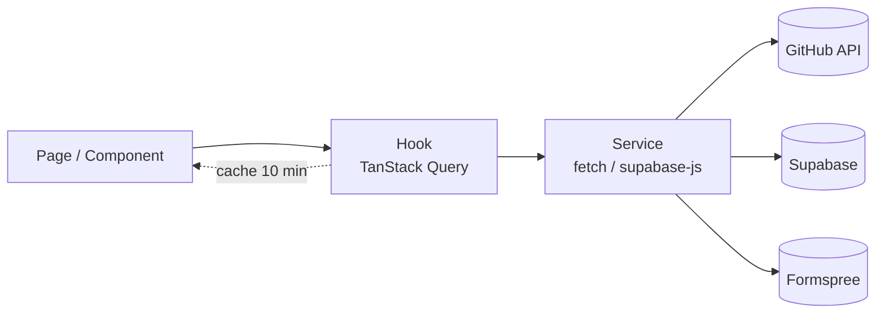

# Portfólio React

Portfólio de desenvolvimento front-end. Os projetos são lidos direto da API do GitHub, as
mensagens do formulário de contato chegam por e-mail e ficam salvas em um painel protegido
por login, e a home tem uma cena 3D interativa carregada sob demanda.

- **Site publicado:** `https://SEU-PROJETO.vercel.app` (preencha após o deploy)
- **Repositório:** `https://github.com/SEU-USUARIO/portfolio`

## Funcionalidades

- Projetos carregados do GitHub, sem cadastro manual, com página própria por repositório
  (`/projetos/nome-do-repo`), filtro por linguagem e cache para não repetir requisições
- Estados de carregamento (skeleton), erro (com "tentar de novo") e lista vazia em todo dado remoto
- Formulário de contato com validação por campo, envio por e-mail (Formspree) e cópia salva no Supabase
- Painel do dono protegido por login: mensagens (marcar como respondida) e seleção dos projetos em destaque
- Tema claro/escuro lembrado entre visitas, sem "piscada" ao abrir
- Layout responsivo, componentes reaproveitados e cena 3D (React Three Fiber) em telas grandes
- Páginas 404 e de erro amigáveis; links diretos e F5 funcionam em qualquer rota

## Stack

| Área          | Tecnologia                                                                 |
| ------------- | -------------------------------------------------------------------------- |
| Base          | React 19, Vite, JavaScript                                                 |
| Estilo        | Tailwind CSS v4 (tokens de cor para os temas)                              |
| Rotas         | React Router v7 (rotas com `lazy`)                                         |
| Dados remotos | TanStack Query (cache, loading, erro, retry)                               |
| Formulários   | React Hook Form + Zod                                                      |
| Backend       | Supabase (Auth + Postgres com RLS), Formspree                              |
| 3D            | three.js + React Three Fiber                                               |
| Qualidade     | ESLint, Prettier, Husky, lint-staged, commitlint, Vitest + Testing Library |
| Deploy        | Vercel (deploy automático a cada push na `main`)                           |

As comparações e justificativas de cada escolha estão em
[`docs/stack-decisions.md`](docs/stack-decisions.md).

## Arquitetura

```
src/
  app/          App, rotas (routes.jsx), layouts e providers globais
  pages/        uma página por rota; só monta componentes e chama hooks
  components/
    ui/         peças genéricas reutilizadas (Button, Card, Field, Skeleton, QueryState...)
    layout/     Header, Footer, ThemeToggle
    home/ projects/ contact/ dashboard/ auth/   componentes por funcionalidade
  hooks/        lógica com estado e chamadas a serviços (useRepos, useContactForm...)
  services/     único lugar que fala com APIs externas (GitHub, Supabase, Formspree)
  schemas/      validação com Zod
  contexts/     tema e autenticação
  lib/          funções puras (formatação, erros, seleção de destaques)
  config/       variáveis de ambiente e textos do site
```

Fluxo de dados (o componente nunca fala com a API diretamente):



**Critério para dividir componentes:** uma peça vira componente de `ui/` quando aparece em
mais de uma tela ou não conhece o domínio (Button, Card, Field). Vira componente de
funcionalidade quando conhece o domínio (ProjectCard). Páginas só compõem. Qualquer regra
com estado ou chamada externa sobe para um hook.

## Como rodar

Requisitos: Node 20 ou superior.

```bash
git clone https://github.com/SEU-USUARIO/portfolio.git
cd portfolio
npm install
cp .env.example .env   # preencha as variáveis (veja abaixo)
npm run dev            # http://localhost:5173
```

Sem preencher o `.env`, o site abre normalmente: os projetos vêm do usuário de exemplo do
GitHub e os recursos que dependem do Supabase/Formspree mostram "não configurado".

### Variáveis de ambiente

Todas começam com `VITE_` e são **públicas** (vão para o navegador). Nunca coloque segredos
nelas. Veja `.env.example`.

| Variável                 | Para quê                                           |
| ------------------------ | -------------------------------------------------- |
| `VITE_OWNER_NAME`        | Seu nome (cabeçalho, título das páginas)           |
| `VITE_OWNER_ROLE`        | Cargo exibido na home                              |
| `VITE_OWNER_EMAIL`       | E-mail exibido na página de contato                |
| `VITE_GITHUB_USERNAME`   | Usuário do GitHub de onde os projetos são lidos    |
| `VITE_EXCLUDED_REPOS`    | Repositórios a esconder, separados por vírgula     |
| `VITE_SUPABASE_URL`      | URL do projeto Supabase                            |
| `VITE_SUPABASE_ANON_KEY` | Chave pública (anon/publishable) do Supabase       |
| `VITE_FORMSPREE_FORM_ID` | ID do formulário no Formspree (e-mail para o dono) |

### Configurando o Supabase (uma vez)

1. Crie um projeto em supabase.com e copie a URL e a chave `anon` para o `.env`.
2. Em **Authentication > Providers > Email**, desative "Allow new users to sign up".
3. Em **Authentication > Users**, crie o seu usuário (e-mail e senha). É com ele que você entra em `/entrar`.
4. No **SQL Editor**, execute o conteúdo de [`supabase/schema.sql`](supabase/schema.sql). Ele cria as
   tabelas e as regras de segurança (RLS): visitantes só conseguem enviar mensagens; só o dono lê.

### Configurando o e-mail (Formspree)

Crie um formulário em formspree.io, confirme o seu e-mail e copie o ID (o trecho final da
URL `formspree.io/f/ID`) para `VITE_FORMSPREE_FORM_ID`.

## Deploy (Vercel)

1. Importe o repositório na Vercel (framework Vite é detectado sozinho).
2. Cadastre as variáveis `VITE_*` em **Settings > Environment Variables**.
3. Pronto: cada push na `main` publica automaticamente, e cada Pull Request ganha uma URL de preview.

O `vercel.json` reescreve qualquer caminho para o `index.html`, o que mantém links diretos e
o F5 funcionando em rotas como `/projetos/meu-app`.

## Scripts

| Comando                | O que faz                                     |
| ---------------------- | --------------------------------------------- |
| `npm run dev`          | Servidor de desenvolvimento                   |
| `npm run build`        | Build de produção                             |
| `npm run preview`      | Serve o build localmente                      |
| `npm run analyze`      | Build + `stats.html` com o tamanho dos chunks |
| `npm run lint`         | ESLint                                        |
| `npm run format:check` | Confere a formatação (Prettier)               |
| `npm test`             | Testes (Vitest)                               |

## Padrões do projeto

Estes padrões também estão no [`CLAUDE.md`](CLAUDE.md), que é lido pela IA a cada sessão.

**Commits.** [Conventional Commits](https://www.conventionalcommits.org/) em português, no
imperativo: `feat: adiciona validação do formulário de contato`. Tipos: `feat`, `fix`,
`refactor`, `test`, `docs`, `style`, `perf`, `chore`, `ci`. O `commitlint` recusa mensagens fora do padrão.

**Branches.** GitHub Flow. A `main` está sempre publicável. Cada funcionalidade nasce em
`feature/<nome>` (correções em `fix/<nome>`) e entra na `main` por merge `--no-ff` ou Pull Request,
depois de lint, testes e build passarem. Nada de commit direto na `main`.

**Nomenclatura.** Componentes em `PascalCase.jsx`; hooks `useCamelCase.js`; serviços, libs e
schemas em `camelCase.js`; testes ao lado do arquivo (`Nome.test.jsx`); constantes em `UPPER_SNAKE_CASE`.

**Qualidade automática.** A cada commit o Husky roda `lint-staged` (ESLint + Prettier nos arquivos
alterados) e `commitlint`. O CI do GitHub Actions repete lint, formatação, testes e build.

## Testes

```bash
npm test
```

Cobrem: validação do formulário de contato (mensagem por campo, botão bloqueado durante o envio,
campo anti-robô, erro de envio), bloqueio do painel sem login (guarda de rota e rota real),
página 404, deep link, serviço do GitHub (limite de requisições, rede, filtros), seleção de
destaques, formatadores e persistência do tema.

## Performance

- Home carrega só o pacote essencial. Painel, login, formulário, páginas de projeto, Supabase e a
  cena 3D são chunks separados, baixados sob demanda.
- A cena 3D só carrega em telas largas, sem preferência por menos movimento e com o navegador
  ocioso. No celular entra uma ilustração SVG leve.
- Skeletons com a mesma altura dos cards, imagens com `width`/`height` e `loading="lazy"`: sem
  salto de layout.
- Cache do TanStack Query (10 min) evita repetir chamadas à API do GitHub ao navegar.
- Lighthouse (mobile, build local): performance **97**, LCP 1,9 s, TBT 140 ms, CLS 0.

## Harness de IA

O projeto foi desenvolvido com o Claude Code e um conjunto versionado de instruções, hooks, skills,
agentes e MCPs que fazem a IA seguir os padrões acima. Detalhes em
[`docs/ai-harness.md`](docs/ai-harness.md).

## Documentação extra

- [`docs/requisitos.md`](docs/requisitos.md): enunciado original
- [`docs/requisitos-checklist.md`](docs/requisitos-checklist.md): onde cada requisito foi atendido
- [`docs/stack-decisions.md`](docs/stack-decisions.md): opções comparadas, critério e o que foi aceito perder
- [`docs/ai-harness.md`](docs/ai-harness.md): o harness de IA
- [`docs/video-roteiro.md`](docs/video-roteiro.md): roteiro do vídeo de entrevista
